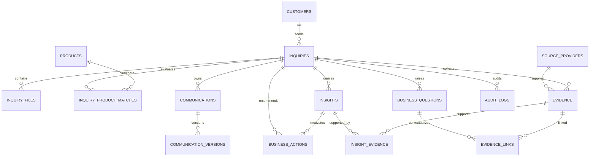

# Exporbit PostgreSQL 初始数据模型

## 1. 设计原则

- UUID 主键；所有业务表带 `created_at`, `updated_at`，可编辑聚合根带 `revision`。
- 事实状态统一为 `CONFIRMED | INFERRED | NEEDS_CONFIRMATION | INSUFFICIENT_DATA | UNAVAILABLE`。
- 人工值和 AI 值不互相覆盖：重要可编辑记录保存 `value`, `value_status`, `updated_by_type`, `updated_by_id`；变更写审计。
- Evidence 保存可访问快照、哈希、来源时间和 Provider 元数据；外部链接失效不删除历史证据。
- MVP 使用关系表和 JSONB 的有限组合，不为每种提取字段创建复杂 EAV。

## 2. ER 图

## 3. 核心表

| Table | 关键字段 | 关系/约束 |
|---|---|---|
| `customers` | id, legal_name, website, country_code, profile JSONB, status, revision | normalized name index；website 可空 |
| `inquiries` | id, customer_id, subject, raw_text, source_type, workflow_status, extracted_fields JSONB, content_hash, revision | customer FK; `(content_hash, customer_id)` 非唯一索引用于重复提示 |
| `inquiry_files` | id, inquiry_id, storage_key, original_name, media_type, byte_size, sha256, parse_status, error_code | inquiry FK；`sha256` index；不保存密钥/绝对客户端路径 |
| `products` | id, sku, name, specifications JSONB, moq, capabilities JSONB, status, revision | `sku` unique |
| `inquiry_product_matches` | id, inquiry_id, product_id, overall_status, dimension_results JSONB, rationale, origin, confirmed_by, revision | `(inquiry_id, product_id)` unique；维度值为 MATCH/MISMATCH/UNKNOWN |
| `business_questions` | id, inquiry_id, text, status, origin, sort_order, revision | inquiry + status index |
| `source_providers` | id, code, category, display_name, mode, enabled, config_ref, last_health_status | `code` unique；mode=LIVE/MANUAL/DEMO/PLANNED；不存凭据正文 |
| `evidence` | id, inquiry_id, provider_id, source_category, title, canonical_url, captured_text, source_published_at, captured_at, content_hash, credibility_status, availability_status, is_demo | inquiry/provider FKs；hash、category、captured_at indexes |
| `evidence_links` | id, evidence_id, business_question_id, relation_type, note | `(evidence_id, business_question_id)` unique |
| `insights` | id, inquiry_id, statement, status, origin, model_run_id, revision | inquiry + status index；不把 AI 推断标成 confirmed |
| `insight_evidence` | insight_id, evidence_id, support_type | composite PK；support_type SUPPORTS/CONTRADICTS/CONTEXT |
| `business_actions` | id, inquiry_id, insight_id, title, rationale, status, priority, owner_id, origin, confirmed_at, revision | inquiry + status + priority index |
| `communications` | id, inquiry_id, purpose, current_version_id, status, revision | inquiry FK；不含自动发送字段 |
| `communication_versions` | id, communication_id, version_number, language, tone, body, origin, created_by, based_on_version_id | `(communication_id, version_number)` unique；版本不可变 |
| `audit_logs` | id, actor_id, actor_type, inquiry_id, entity_type, entity_id, action, before_json, after_json, request_id, created_at | entity/time、inquiry/time indexes；append-only |
| `model_runs` | id, provider_code, model, purpose, status, input_hash, token_input, token_output, latency_ms, error_code, created_at | 不默认保存完整敏感 prompt；按 purpose/time 索引 |

## 4. 所有权和覆盖规则

1. AI 抽取写入 `extracted_fields` 时为每个字段保存 value/status/origin/evidence refs。
2. 用户修改后 origin 变为 HUMAN、revision 增加、audit log 记录前后值。
3. 重跑分析写新 `model_run`，只更新仍由 AI 拥有的字段；人工字段产生 suggestion，等待用户接受。
4. Communication version 只新增不更新；恢复历史版本时创建一个以旧版本为基础的新版本，避免篡改历史。
5. 删除 Provider 不级联删除 Evidence；Provider 应软禁用，证据快照继续可查。

## 5. 索引与保留

- 常用列表：`inquiries(workflow_status, updated_at desc)`、`inquiries(customer_id, created_at desc)`。
- 匹配：unique `(inquiry_id, product_id)`。
- 证据：`evidence(inquiry_id, captured_at desc)`、`evidence(content_hash)`。
- 审计：`audit_logs(entity_type, entity_id, created_at desc)`。
- JSONB 只在真实查询模式出现后添加 GIN，避免先验索引。
- MVP 默认不硬删除询盘、证据、版本和审计；正式保留期限与隐私删除流程待确认。

## 6. 待确认

- 单用户比赛版之后的 tenant/account 模型与数据隔离键。
- 客户隐私与原始询盘保留期限、删除/导出要求。
- 文件大小、格式白名单、病毒扫描和备份策略。
- 是否需要产品档案字段级版本；MVP 可由审计日志满足。
