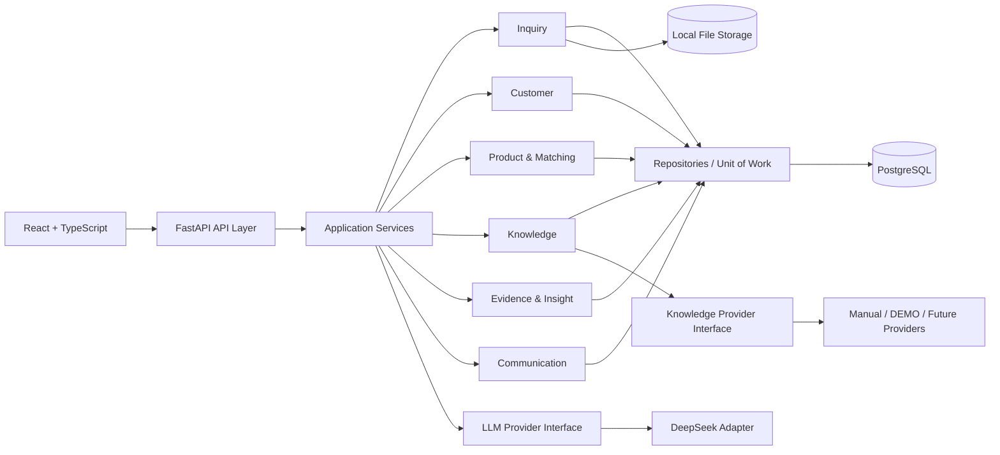

# Exporbit 技术审计与 MVP 架构

## 1. 当前实现审计

### 1.1 原型结构

现有 `prototype/` 是单页 React 19 + Vite 6 演示应用。`App.jsx` 由 `Header`、`Nav`、`WorkHead`、`Snapshot`、`Matching`、`Knowledge`、`Reply`、`Actions`、`Import`、`Drawer` 等局部组件组成；询盘列表、详情、文本/文件导入和结构化提取已接入 FastAPI，其他主要业务域仍是演示实现，且没有生产鉴权。

| 能力 | 当前行为 | 判定 |
|---|---|---|
| 询盘列表、搜索、筛选、切换 | 询盘列表与详情来自 API/PostgreSQL；搜索和筛选在当前列表执行 | API-backed |
| 文本/PDF/图片/EML 导入 | 文本走询盘 API；文件 multipart 逐件解析并展示预览/成功失败；原文件、解析结果和元数据持久化 | P0 文件导入已接入 |
| Snapshot | Nordlicht 固定数据，其他询盘为简化占位 | 静态/DEMO |
| 产品匹配 | 可修改二维匹配状态并写入 localStorage | 可交互 DEMO |
| 知乎研究 | 3 条硬编码内容、定时器模拟搜索、外链到知乎首页 | DEMO，非实时 API |
| Evidence-to-Action | 加入证据会改变证据数量和两段固定条件文案 | 规则化演示，不是 AI 推理 |
| 商务回复 | 定时器生成固定中/英文模板；可编辑、保存、恢复版本 | 可交互 DEMO |
| 数据持久化 | `tp_*` localStorage keys | 单浏览器演示，不是业务持久化 |
| 构建/测试 | `npm run build`; `npm run test:sites`（4 tests） | 已验证通过 |

状态由 React `useState` 和自定义 `useStored` 管理。没有集中 store。对当前规模这是合理的；API client 使用 `fetch` 接入询盘流程，其余模拟行为仍来自硬编码数据和 `setTimeout`。

### 1.2 可复用资产

- 三栏工作区、渐进式信息层级、状态标签、匹配矩阵、Evidence Drawer、Action Panel。
- 已确认的交互文案、Nordlicht 演示路径、DEMO 标识和人工修正模式。
- Vite/Sites 构建、静态 worker 与测试脚本。

### 1.3 风险与缺口

- `App.jsx` 单文件且为 JSX；产品化应按功能逐步拆分并迁移 TypeScript，但不需要重写视觉层。
- localStorage key 未按询盘/用户完全隔离，多个询盘可共享匹配、证据和行动状态。
- 生成回复固定为 Nordlicht；切换询盘后会发生数据语义错配。
- CSS 设置 `body{min-width:1180px}`，小屏会水平溢出；桌面优先可接受，但平板/移动不可用。
- 多个仅图标按钮缺少可访问名称；模态框缺少 dialog 语义、焦点圈定、Esc 关闭；toast 无 live region。
- Google Fonts 为运行时外部依赖；离线/受限网络会回退。
- 无单元/组件/E2E 测试覆盖业务交互，现有测试只验证 Sites 包装。

## 2. 目标架构



推荐目录（规划，不在本阶段创建空模块）：

```text
backend/app/
  api/             # routers, request/response schemas, dependencies
  application/     # use cases and transaction boundaries
  domains/         # inquiry, customer, product, knowledge, evidence, action, communication
  providers/       # llm, documents, knowledge interfaces and adapters
  infrastructure/  # SQLAlchemy repositories, storage, logging
  core/            # config, errors, auth context, shared enums
```

### 分层规则

- API 只做鉴权上下文、校验、状态码与 DTO 转换。
- Application service 编排事务和 Provider；领域规则不依赖 FastAPI/DeepSeek。
- Repository 隐藏 SQLAlchemy 查询；不过度建立通用 repository。
- Provider 输出统一、可验证、包含 provenance 和运行元数据。
- 同一请求内使用数据库事务；外部调用不持有长事务。

## 3. P0 产品到技术映射

| P0 | Frontend | Backend / entities | API | AI / Provider | 失败与降级 |
|---|---|---|---|---|---|
| Inquiry Import | 文本/文件、进度、重试、重复提示 | import service; inquiry, file metadata | `POST /inquiries`, `/inquiries/{id}/files` | DocumentParser | 保留原文件与失败原因；允许重试/手工录入 |
| Inquiry Parsing | 解析状态、可编辑字段 | parsing service; inquiry fields, audit | `POST /inquiries/{id}/parse` | LLM + parser | `NEEDS_CONFIRMATION`; 不覆盖人工值 |
| Business Snapshot | 状态标签与刷新 | snapshot query service | `GET /inquiries/{id}/snapshot` | 可使用 LLM 汇总 | Provider 失败仍显示已保存事实 |
| Customer Intelligence | 来源、可信状态、风险信号 | customer service; customers/evidence | `GET/PATCH /customers/{id}` | Knowledge providers | 不生成无依据风险分；允许不可用 |
| Product Matching | 多候选、逐项修正 | matching service; products/matches | `/inquiries/{id}/product-matches` | 可选候选排序 | 缺数据为 UNKNOWN；人工修正优先 |
| Knowledge Intelligence | 问题编辑、Provider 开关、结果 | research service; questions/providers | `/inquiries/{id}/questions`, `/research-runs` | Knowledge providers | 单源失败隔离；手工导入仍可用 |
| Evidence Management | 收藏、关联、原文抽屉 | evidence service; evidence/links | `/inquiries/{id}/evidence` | 可选摘要 | 保存来源快照；链接失效仍可追溯 |
| Evidence-to-Action | 可追溯链 | insight service; insights/evidence links | `/inquiries/{id}/insights` | LLM structured output | 无证据不生成确定结论；标记不足 |
| Business Actions | 确认/修改/完成 | action service; business_actions/audit | `/inquiries/{id}/actions` | AI 仅建议 | 人工状态持久化；并发冲突返回 409 |
| Communication Studio | 生成、编辑、保存、恢复 | communication service; versions | `/inquiries/{id}/communications` | LLM provider | 生成失败可手工编辑；禁止自动发送 |
| Human Review | 修改来源、确认状态 | review service; audit_logs | `PATCH` + confirmation endpoints | 无强依赖 | 乐观锁；AI 重跑不覆盖人工字段 |
| Data Persistence | 加载/保存/错误恢复 | repositories/UoW; PostgreSQL/storage | 全部资源 API | 无 | 事务回滚、幂等 key、可观测错误 |

## 4. 错误、认证与审计

- 错误响应使用稳定 `code`, `message`, `details`, `request_id`；不向客户端暴露堆栈或 Provider 密钥。
- Provider 超时映射为 503/可重试状态；校验失败为受控的 analysis failure，而非写入部分可信结果。
- 比赛版可先使用单用户开发身份，但 API 从第一天接收 `actor_id` 上下文；生产鉴权方案仍需确认。
- 记录 request id、actor、资源、动作、结果、耗时和 provider run id；日志中脱敏询盘正文和凭据。
- 人工字段采用 `updated_by_type=HUMAN` 与 revision；AI 重跑仅生成新分析或更新 AI-owned 字段。

## 5. 准入结论

架构边界足以开始**受控的后端骨架与 POC**，但不应直接进入完整 MVP 批量开发。必须先验证结构化抽取、文件解析、来源快照和 PostgreSQL 事务/并发策略；知乎实时获取仍是独立高风险项，不能阻塞核心工作流。
